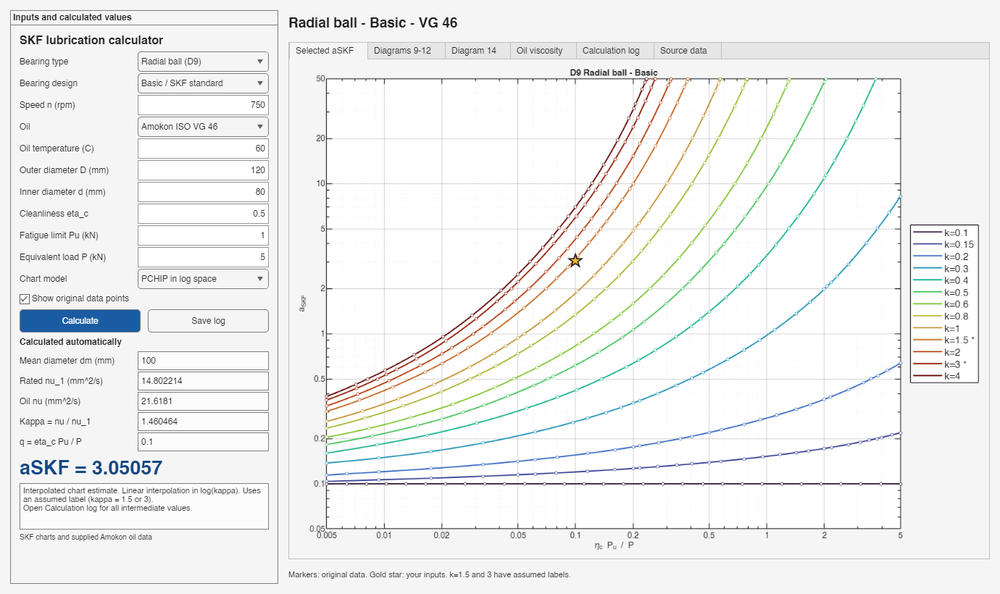

# SKF Bearing Life Calculator

MATLAB R2025b GUI for calculating the SKF bearing life modification factor
(aSKF), featuring digitized SKF diagrams, oil viscosity data, logarithmic
interpolation, and detailed calculation logs.



## Run the MATLAB version

Open this folder as the MATLAB R2025b Current Folder and run:

```matlab
SKF_Life_App
```

Keep `skf_data.json`, `diagram14_data.json`, and the `Lubs` folder alongside
the source files. See [the Persian guide](LUBRICATION_FA.md) and
[the extraction documentation](README_FA.md).

## Run the Windows standalone version

Download the Windows ZIP from this repository's GitHub Releases, extract
it, install **MATLAB Runtime R2025b for Windows 64-bit**, and double-click
`SKF_Bearing_Life.exe`. A MATLAB license is not required for the end user.
The chart and oil databases are embedded in the executable.

Runtime download: https://www.mathworks.com/products/compiler/matlab-runtime.html

## Build the standalone executable

MATLAB R2025b and a MATLAB Compiler license are required for building.
From this project folder, run:

```matlab
build_standalone
```

The Windows executable is written to `dist/windows`. The build stages
source files in a temporary directory to support project paths containing
semicolons. Distribute the compiled binary through GitHub Releases;
generated build files are excluded by `.gitignore`.

## Inputs and calculations

Select bearing type, Basic or Explorer design, speed, oil grade,
temperature, inner/outer diameters, cleanliness factor eta_c, fatigue load
limit Pu, and equivalent dynamic load P. The app calculates mean diameter,
rated viscosity, oil viscosity, kappa, eta_c*Pu/P, and aSKF.

The light interface includes SKF Diagrams 9–12, Diagram 14, oil curves,
source data, and a calculation log. PCHIP in logarithmic coordinates is
the default chart model; original PDF vector evaluation is also available.

## Data limitations

- The two unlabelled kappa curves are assigned **1.5 and 3 as assumptions**.
- Diagram 11 has no Explorer data in the source document; that combination
  is marked unavailable rather than filled with invented values.
- Input extrapolation outside the supported chart/oil domains is rejected.
- Kappa above 4 is evaluated at 4; visible aSKF ceiling handling is logged.
- This is an independent project, not an official SKF application.

## Validation

Run `validate_skf` in MATLAB R2025b for numerical and GUI regression checks.
Source overlays and validation reports are included in this repository.
The standalone executable also supports an optional smoke check through
the `SKF_STANDALONE_SMOKE_OUTPUT` environment variable: set it to an output
JSON path before launching the executable. Test mode constructs the GUI
invisibly, checks the reference result, writes the calculation, then exits.

No license for the repository's source code has been selected yet.
